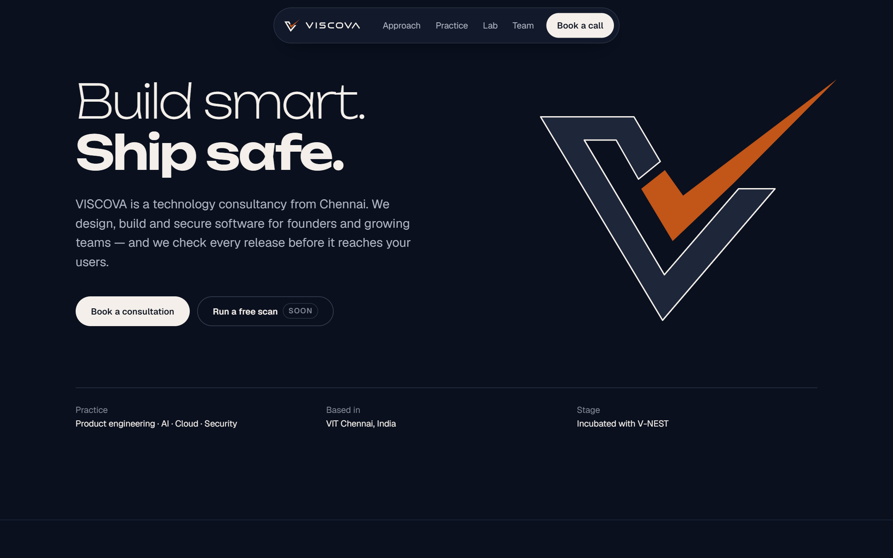
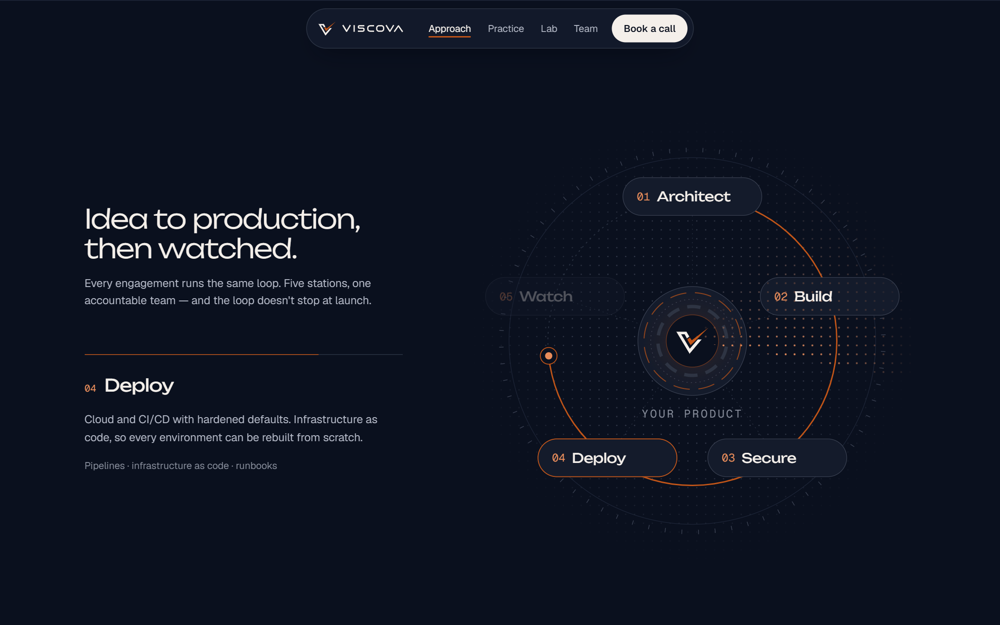
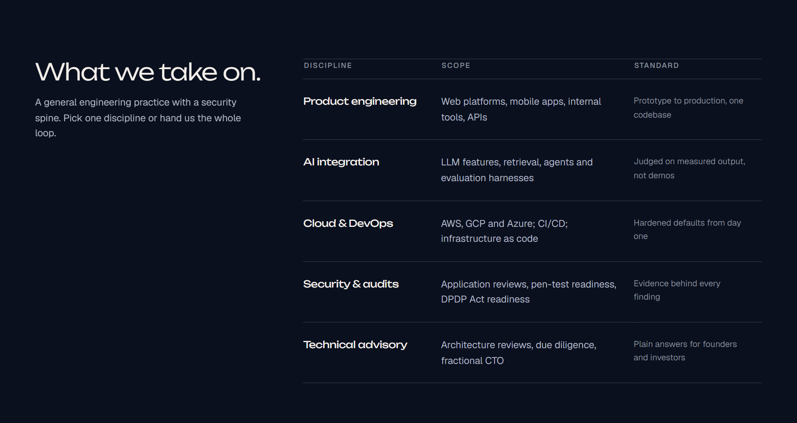
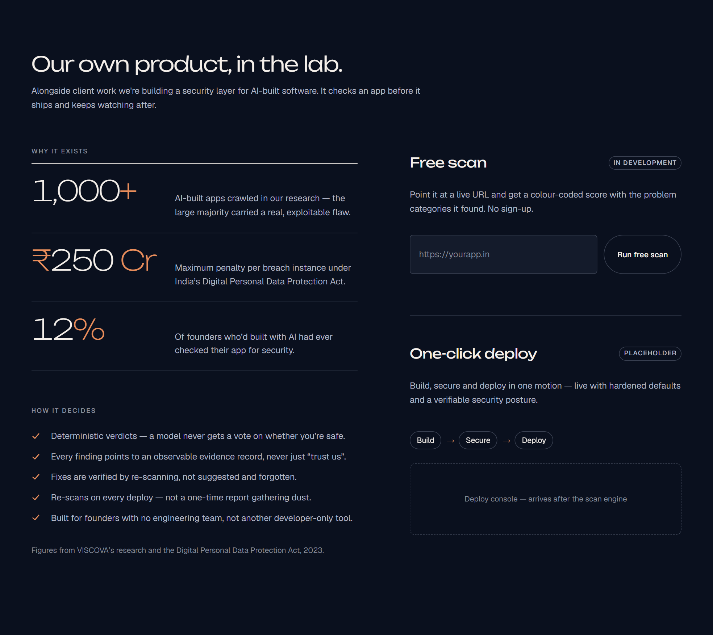
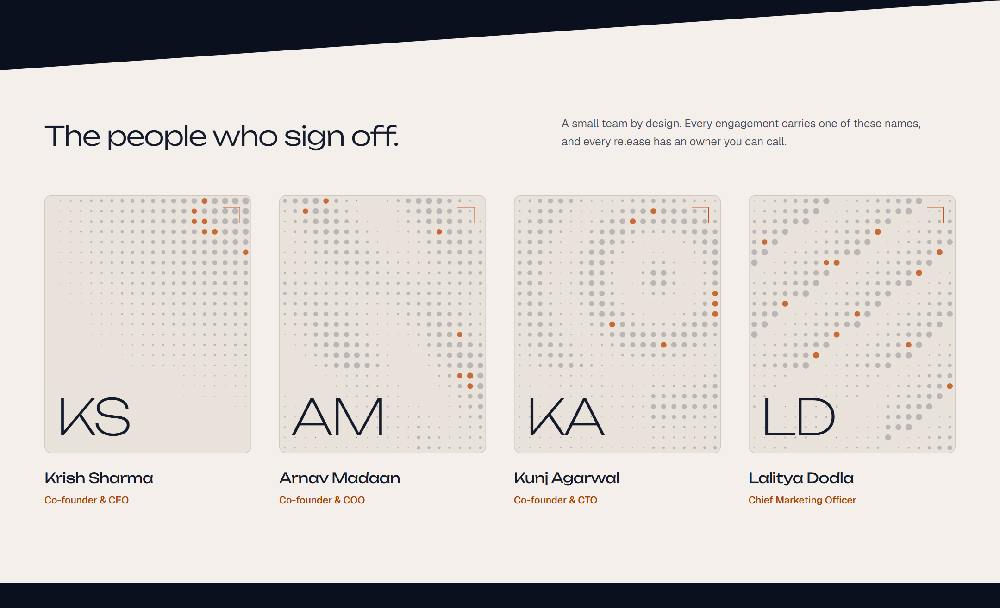
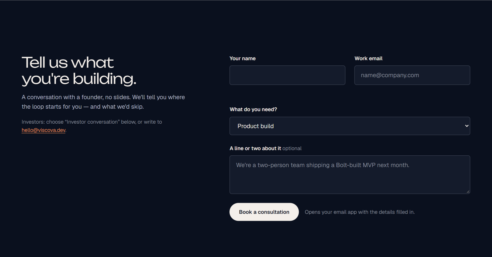
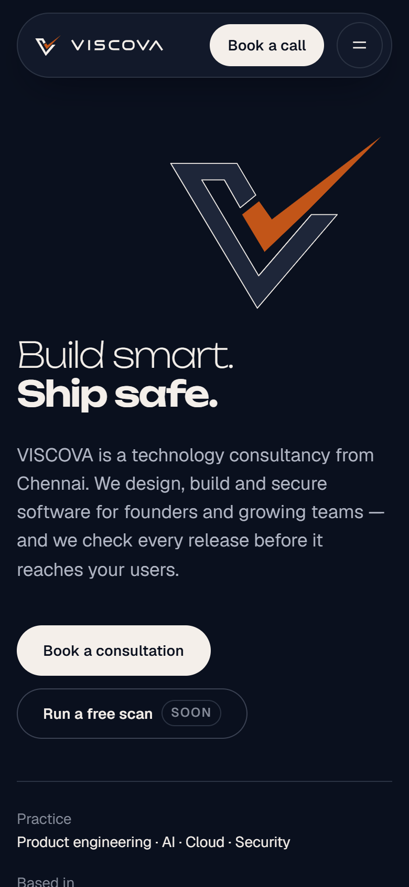
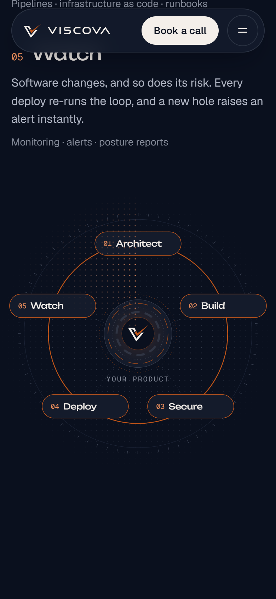

# VISCOVA Technologies — landing page

Static landing page for VISCOVA Technologies Private Limited. Plain HTML, CSS and JavaScript — no build step.

> **Live:** https://viscovaai.github.io/viscova-landing/ (GitHub Pages, from `main`)



## Screenshots

**The loop** — pinned while you scroll; the ring draws itself, each station lights up, and the arc-reactor core reacts to scroll speed.



| What we take on | Our own product, in the lab |
| --- | --- |
|  |  |

| Team | Book a consultation |
| --- | --- |
|  |  |

| Mobile — hero | Mobile — loop |
| --- | --- |
|  |  |

## Run locally

```bash
python -m http.server 4321
```

Then open http://localhost:4321. Opening `index.html` directly in a browser also works.

## Files

- `index.html` — page markup, including the inline SVG logo mark and wordmark
- `tokens.css` — design tokens: colours (from the brochure palette), type, spacing, motion
- `styles.css` — layout and components
- `main.js` — GSAP + ScrollTrigger animations, Lenis smooth scroll, form behaviour
- `assets/viscova-logo.webp` — original logo reference
- `screenshots/` — the images above

## Still to fill in

- Team portraits and bios (look for `TODO` comments in `index.html`)
- Free scan and one-click deploy are placeholders until the features ship
- The consultation form opens a pre-filled email to hello@viscova.dev — there is no backend yet
